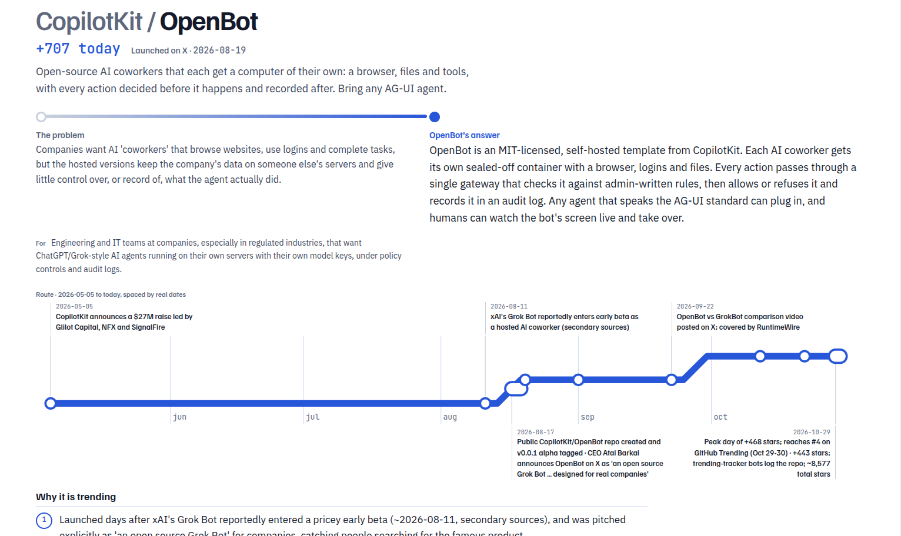

# Trend Analyzer

To understand GitHub trending repos, I had to copy repo URLs and ask an LLM what problem each one solves, and, although many other repos solve the same problem, why this one got so popular. So I made this process automatic for my own use.

This repo analyzes the GitHub daily trending page and gives you a sense of what new problems the world is struggling with and how people are solving them. You may also find sources to follow.

For every trending repo, it answers 3 questions right now:

1. **What problem does this repo solve?**
2. **How did it get popular?**
3. **Where was it introduced** that made it popular?

And it tries to give you the sense of the trending projects, not just the list.

## What you get



A daily report (`reports/<date>-daily.md` and `.json`) with, for each repo:

- the problem, the answer, and who it's for
- why it got popular (a list of reasons)
- where it launched (Hacker News, Reddit, X, a blog...) with the link and date
- a dated timeline, each event with its source
- a confidence level and the list of sources used

See [`reports/`](reports/) for real examples.

## How it works

1. Reads [github.com/trending](https://github.com/trending).
2. Collects evidence for each repo: GitHub repo data, star history and Hacker News posts.
3. Asks Claude (through the local [Claude Code](https://claude.com/claude-code) CLI) to research the repo and answer the questions.
4. Writes the report. Analyses are cached, so a repo that stays trending isn't re-researched every day.


## Usage

```bash
cp .env.example .env    # add GITHUB_TOKEN, optionally CLAUDE_MODEL

# analyze today's trending repos
go run ./cmd/analyze_trending

# options
go run ./cmd/analyze_trending -since weekly -limit 5
#   -since         daily, weekly or monthly (default daily)
#   -limit         max repos to analyze (default 10, 0 = all)
#   -concurrency   repos analyzed in parallel (default 2)
#   -max-age       reuse cached analyses younger than this (default 72h)
#   -model         Claude model alias or id

# just print the trending list
go run ./cmd/github_trending
```

### Web UI

```bash
go run ./cmd/report_server     # API on :8080
cd web && npm install && npm start   # UI on :4200
```

Or build the UI once (`cd web && npm run build`) and `report_server` will serve it too.

